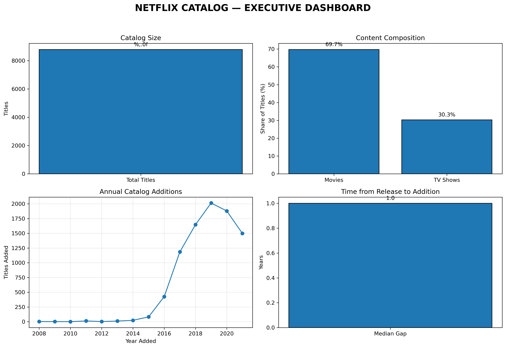
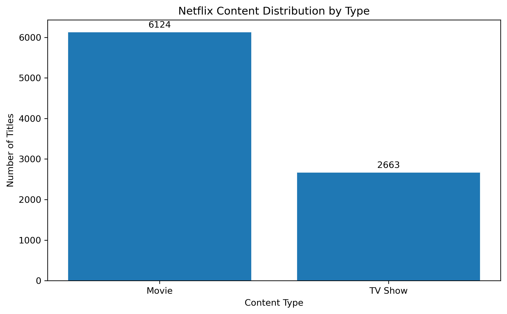
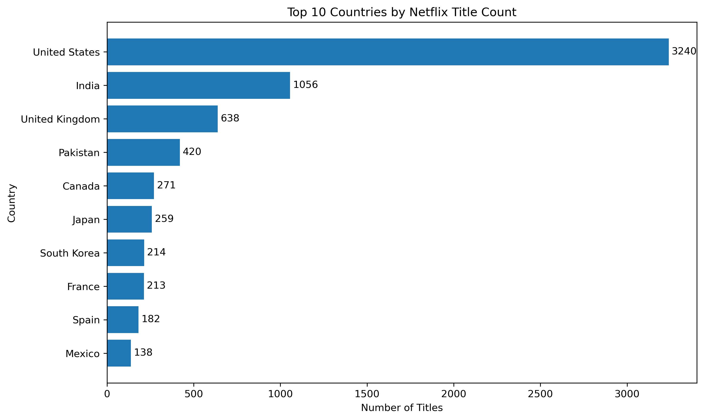
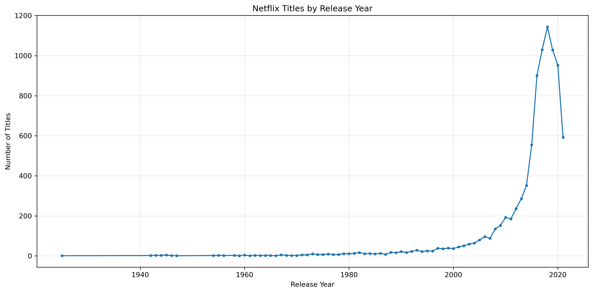
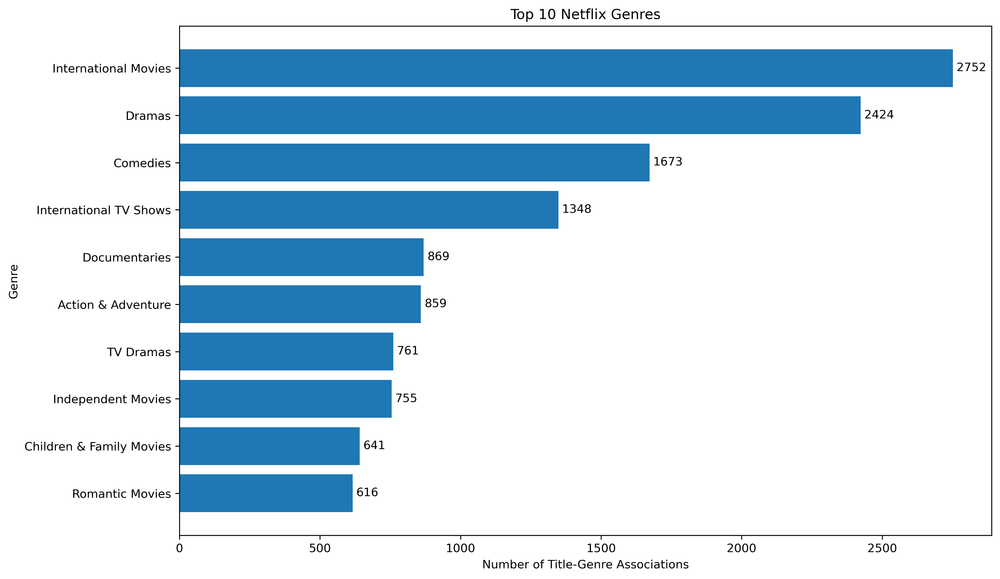
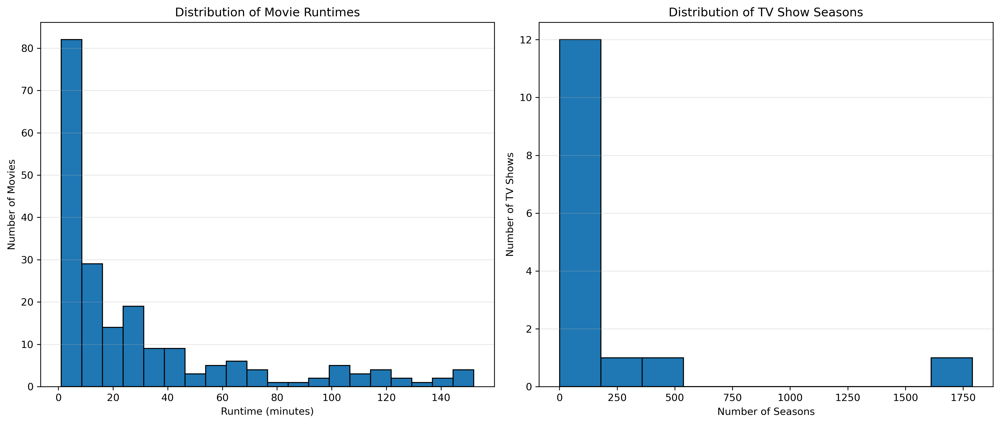

# Netflix Data Analysis Using Python

## Internship Project — Auspify Technologies

## 1. Project Overview

This project analyzes Netflix titles using Python to identify patterns in content types, countries, release years, ratings, genres, catalog additions, and content duration. It also presents business insights and recommendations based on the findings.

The project was completed as part of the Data Analysis Using Python internship at Auspify Technologies.

## 2. Objectives

- Clean and prepare the Netflix dataset.
- Analyze Movies and TV Shows in the catalog.
- Explore content distribution by country and release year.
- Examine content ratings and genre categories.
- Investigate catalog addition trends and content duration.
- Create visualizations and a business intelligence report.
- Provide evidence-based business recommendations.

## 3. Technologies Used

- Python
- pandas
- Matplotlib
- Jupyter Notebook
- Git and GitHub

## 4. Project Structure

```text
Netflix_Fresh/
├── README.md
├── data/
│   ├── raw/
│   │   └── Dataset.csv
│   ├── cleaned/
│   │   └── netflix_cleaned.csv
│   ├── Task_1_Data_Cleaning.ipynb
│   ├── Task_2_Content_Type_Analysis.ipynb
│   ├── Task_3_Country_Analysis.ipynb
│   ├── Task_4_Release_Year_Analysis.ipynb
│   ├── Task_5_Rating_Genre_Analysis.ipynb
│   └── Task_6_Netflix_Business_Insights_Report.ipynb
└── outputs/
    ├── country_analysis.csv
    ├── genre_analysis.csv
    ├── rating_analysis.csv
    ├── release_year_analysis.csv
    └── figures/


## 5. Tasks Completed

1. Data cleaning and preprocessing.
2. Content type analysis.
3. Country analysis.
4. Release year analysis.
5. Rating and genre analysis.
6. Advanced Netflix business insights report.

## 6. Key Findings

- The cleaned dataset contains 8,787 titles and 10 columns.
- Movies represent approximately 69.69% of the catalog.
- TV Shows represent approximately 30.31% of the catalog.
- Catalog additions peaked in 2019, with 2,014 titles.
- The median release-to-addition gap is one year.
- TV-MA is the most frequent content rating.
- International Movies is the most frequent genre/category label.

## 7. Visualizations and Outputs

The project includes charts for content composition, release year trends, countries, ratings, genres, catalog additions, content duration, and an executive dashboard.

Analysis results are exported as CSV files in the outputs/ directory.


### Executive Dashboard


### Content Type Distribution


### Top Countries


### Release-Year Trends


### Top Genres


### Content Duration


## 8. Business Recommendations

- Improve the completeness of country and director metadata.
- Investigate historical catalog addition patterns.
- Evaluate older content using viewing and cost data where available.
- Review content distribution alongside audience engagement metrics.
- Validate date inconsistencies before drawing further conclusions.

## 9. Limitations

The dataset covers catalog additions from 2008 to 2021. It does not contain viewing hours, subscriber behavior, revenue, or licensing costs. Therefore, this analysis describes catalog patterns rather than actual audience preferences or financial performance.

## 10. How to Run

1. Install Python and Jupyter Notebook.
2. Install the required libraries:

   pip install pandas matplotlib jupyter

3. Open the project directory.
4. Launch Jupyter Notebook.
5. Run the task notebooks in order, from Task 1 to Task 6.

## 11. Author

Richard Were Onywera

Data Analysis Using Python Internship
Auspify Technologies
